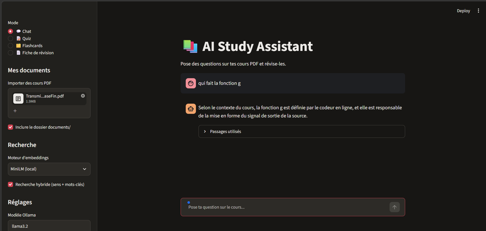
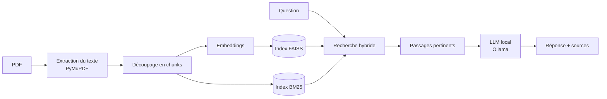

# 📚 AI Study Assistant

Assistant d'étude **100 % local** : importez vos cours en PDF, posez-leur des questions et révisez avec des quiz, des flashcards et des fiches. Les réponses s'appuient sur vos documents et citent leurs sources (fichier, page, score).

Aucune clé d'API, aucun abonnement : tout tourne sur votre PC avec [Ollama](https://ollama.com). Vos cours ne quittent jamais votre machine.

<!-- Ajoutez une capture d'écran : docs/capture.png -->
<!--  -->

## Fonctionnalités

- **💬 Chat sur vos cours (RAG)** : la réponse est rédigée à partir des passages retrouvés dans vos PDF, avec les sources affichées sous chaque réponse.
- **📝 Quiz** : questions à choix multiple générées depuis le cours, avec correction, explications et score.
- **🗂️ Flashcards** : cartes question/réponse, exportables au format `.tsv` pour Anki.
- **📄 Fiche de révision** : résumé structuré en Markdown, téléchargeable.
- **Recherche hybride** : recherche par le sens (embeddings + FAISS) combinée à une recherche par mots-clés (BM25), pour retrouver aussi les noms précis, symboles et morceaux de code.
- **Deux moteurs d'embeddings** au choix : `paraphrase-multilingual-MiniLM-L12-v2` (local) ou `nomic-embed-text` (via Ollama).
- **Index sauvegardé sur disque** : pas de recalcul tant que les PDF ne changent pas.
- Plusieurs PDF à la fois, import par glisser-déposer ou via le dossier `documents/`.

## Comment ça marche



Le modèle reçoit uniquement les passages retrouvés et la consigne de n'utiliser que ce contexte. Si aucun passage n'est assez pertinent, l'application le dit au lieu de laisser le modèle inventer.

## Prérequis

- Python 3.10 ou plus récent
- [Ollama](https://ollama.com/download) installé et lancé
- Environ 4 Go d'espace disque pour les modèles et les bibliothèques

## Installation (Windows)

```bash
# 1. Récupérer le projet
git clone https://github.com/<votre-compte>/AI-Study-Assistant.git
cd AI-Study-Assistant

# 2. Créer et activer l'environnement virtuel
python -m venv venv
venv\Scripts\activate

# 3. Installer les dépendances
pip install -r requirements.txt

# 4. Télécharger les modèles Ollama
ollama pull llama3.2
ollama pull nomic-embed-text   # optionnel : embeddings plus précis
```

> Placez le projet **hors d'OneDrive** (par exemple `C:\projet`) : la synchronisation ralentit fortement l'installation et le chargement du `venv`.

## Utilisation

```bash
streamlit run app.py
```

ou double-cliquez sur `lancer.bat`, qui libère le port 8501 puis démarre l'application. Ouvrez ensuite <http://localhost:8501>.

1. Importez un ou plusieurs PDF dans la barre latérale, ou placez-les dans `documents/` et cochez **Inclure le dossier documents/**.
2. Attendez la fin de l'indexation.
3. Choisissez un mode (Chat, Quiz, Flashcards, Fiche) et c'est parti.

## Structure du projet

```
AI-Study-Assistant/
├── app.py             # Interface Streamlit
├── rag.py             # Moteur : extraction, embeddings, FAISS, BM25, génération
├── requirements.txt   # Dépendances
├── lancer.bat         # Lancement rapide sous Windows
├── documents/         # Vos cours (non versionnés)
└── index/             # Index générés (non versionnés)
```

## Réglages

| Réglage | Rôle |
|---|---|
| Moteur d'embeddings | MiniLM (local) ou nomic-embed-text (Ollama). Un index est conservé par moteur. |
| Recherche hybride | Combine le sens et les mots-clés. |
| Modèle Ollama | Modèle utilisé pour rédiger (par défaut `llama3.2`). |
| Score minimum | Seuil de pertinence du chat : plus haut = plus strict. |

## Limites connues

- **PDF scannés** : le texte doit être sélectionnable, il n'y a pas d'OCR.
- **Petits modèles** : un modèle de 3 milliards de paramètres peut se tromper ou ajouter des détails. Vérifiez les sources affichées, et relisez les quiz et fiches générés.
- **Gros documents** : les quiz, flashcards et fiches utilisent une sélection de passages (4 à 12), pas tout le cours. Le champ « Sujet précis » permet de cibler un chapitre.
- Si un PDF est ajouté, retiré ou modifié, l'index est reconstruit en entier.
- La qualité de la recherche n'a pas encore été mesurée sur un jeu de questions de référence.

## Dépannage

**`CUDA error` ou `llama-server process has terminated`** : le plantage vient d'Ollama et de la carte graphique, pas de l'application. Forcez d'abord le mode processeur :

```bash
set CUDA_VISIBLE_DEVICES=-1
ollama serve
```

Si Ollama tourne déjà, quittez-le avant (`taskkill /F /IM "ollama app.exe"` puis `taskkill /F /IM ollama.exe`). Une mise à jour du pilote NVIDIA et d'Ollama règle souvent le problème durablement.

**`DLL load failed ... stratégie de contrôle d'application`** : Windows bloque des bibliothèques compilées. Déplacez le projet hors d'OneDrive et recréez le `venv`.

**Page noire dans le navigateur** : d'anciens processus Streamlit occupent le port. Fermez-les avec `taskkill /F /IM python.exe`, ou utilisez `lancer.bat`.

## Technologies

[Streamlit](https://streamlit.io) · [Ollama](https://ollama.com) · [PyMuPDF](https://pymupdf.readthedocs.io) · [FAISS](https://github.com/facebookresearch/faiss) · [sentence-transformers](https://www.sbert.net) · BM25

## Pistes d'amélioration

- Évaluation de la recherche sur un jeu de questions de référence
- OCR pour les PDF scannés
- Mise à jour de l'index uniquement pour les nouveaux PDF